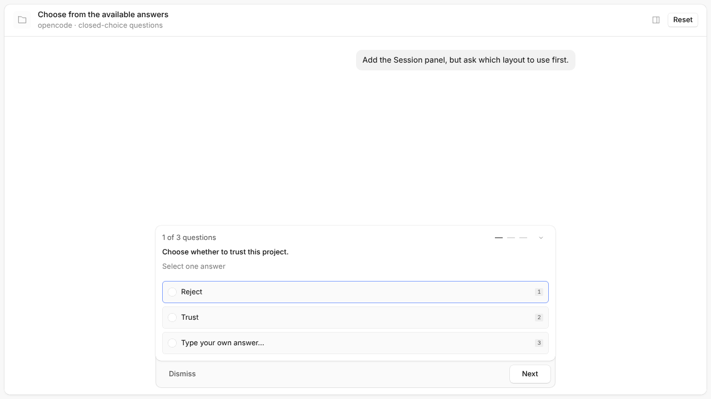
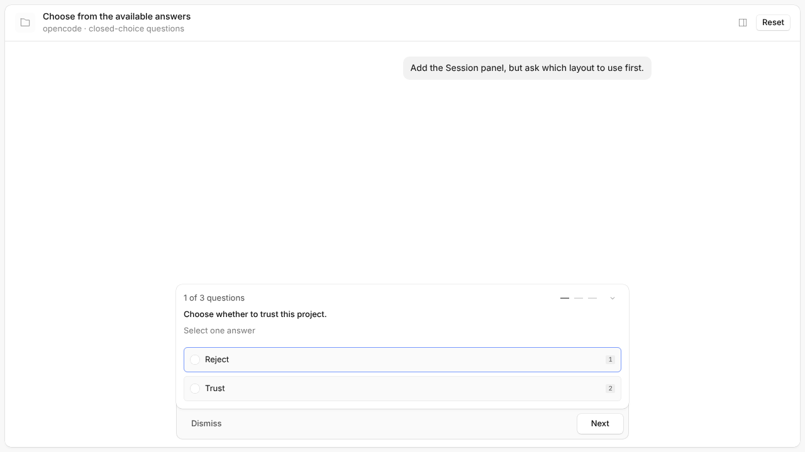
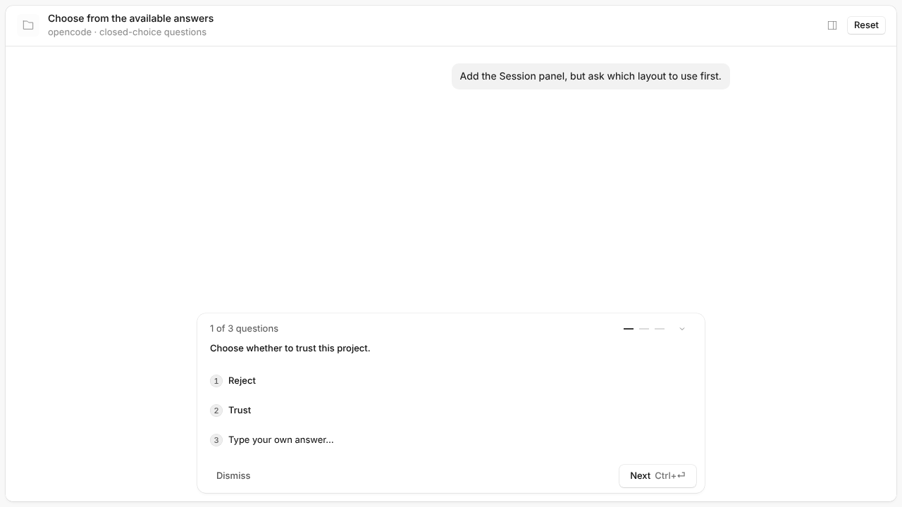
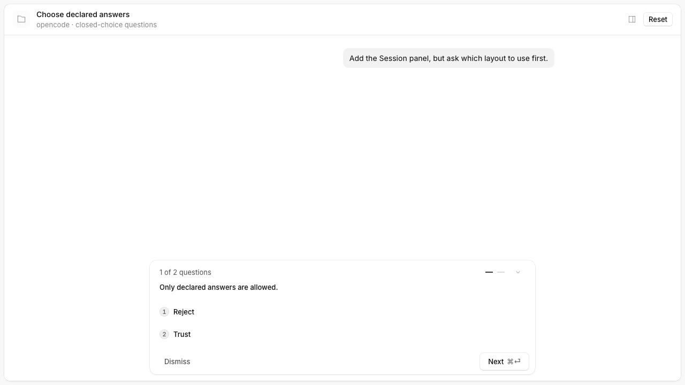

### Issue for this PR

Closes #62032

### Type of change

- [x] Bug fix

### What does this PR do?

Both web question docks now offer custom answers only when the field allows them, matching backend validation. Keyboard navigation and numeric shortcuts use the same answer count. Plain string fields without options remain editable.

Existing stories that exercise custom multiselect answers now explicitly set `custom: true`. No feature flag: this fixes the existing form contract in both question UI variants.

### How did you verify your code works?

- The new browser regression failed on both original docks and passes after the fix; covers closed single/multiple choices, keyboard boundaries, and optionless string input.
- App unit tests: 2,389 passed. Root lint and all 35 typecheck tasks passed, including the pre-push hook.
- Cold component suites: app 265 passed; session UI 199 passed. Neither run reported Vite dependency re-optimization.
- Tried `strobe bench packages/app/perf/question.bench.ts --base origin/dev --head .` (`exp_eadc6f`); Chromium could not open its debugging port in this environment. No performance conclusion.

### Visual

```svg
<svg xmlns="http://www.w3.org/2000/svg" width="240" height="72" viewBox="0 0 240 72"><g fill="none" stroke="currentColor"><rect x="8" y="8" width="224" height="56" rx="6" opacity=".3"/><circle cx="24" cy="25" r="4"/><path d="M36 25h88"/><circle cx="24" cy="47" r="4"/><path d="M36 47h65"/></g><path fill="currentColor" d="M178 34l8 8 17-18" opacity=".8"><animate attributeName="opacity" values=".3;1;.3" dur="2s" repeatCount="indefinite"/></path></svg>
```

### Screenshots / recordings

| Classic before | Classic after |
| --- | --- |
|  |  |

| Experimental before | Experimental after |
| --- | --- |
|  |  |

### Checklist

- [x] I have tested my changes locally
- [x] I have not included unrelated changes in this PR
